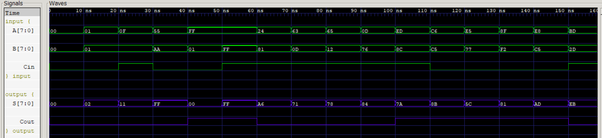

# Entity: brent_kung_adder

- **File**: [brent_kung_adder.v](brent_kung_adder.v)
- **Type**: 8-bit parallel-prefix adder, purely combinational, structural Verilog (gate primitives)
- **Prefix tree**: Brent-Kung (sparse up-sweep and down-sweep)
- **Functional status**: ✅ Passes an exhaustive test of all 2¹⁷ = 131,072 `{Cin, A, B}` combinations

## Diagram

### Logisim schematic


Source circuit: [BKA.circ](BKA.circ) (open with Logisim-evolution)

### Module symbol


## Ports

| Port name | Direction | Type  | Description |
| --------- | --------- | ----- | ----------- |
| A         | input     | [7:0] | First 8-bit operand (unsigned or two's complement) |
| B         | input     | [7:0] | Second 8-bit operand |
| Cin       | input     |       | Carry-in into bit 0 |
| S         | output    | [7:0] | 8-bit sum, `S = (A + B + Cin) mod 256`. **Note:** this port is named `S`; the other four adders call it `SUM`. |
| Cout      | output    |       | Carry-out of bit 7 (the 9th bit of `A + B + Cin`) |

## Signals

Notation: `G[i:j]` / `P[i:j]` are the group generate / propagate over bits *i* down to *j*. `C[i]` is the carry **into** bit *i*.

| Name  | Type       | Description |
| ----- | ---------- | ----------- |
| G     | wire [7:0] | Bitwise generate, `G[i] = A[i] & B[i]` |
| P     | wire [7:0] | Bitwise propagate, `P[i] = A[i] ^ B[i]`. Also reused as the half-sum for the final XOR. |
| G1_1  | wire       | Stage 1 group generate `G[1:0]` |
| G1_3  | wire       | Stage 1 group generate `G[3:2]` |
| G1_5  | wire       | Stage 1 group generate `G[5:4]` |
| G1_7  | wire       | Stage 1 group generate `G[7:6]` |
| P1_1  | wire       | Stage 1 group propagate `P[1:0]` |
| P1_3  | wire       | Stage 1 group propagate `P[3:2]` |
| P1_5  | wire       | Stage 1 group propagate `P[5:4]` |
| P1_7  | wire       | Stage 1 group propagate `P[7:6]` |
| G2_3  | wire       | Stage 2 group generate `G[3:0]` |
| G2_7  | wire       | Stage 2 group generate `G[7:4]` |
| P2_3  | wire       | Stage 2 group propagate `P[3:0]` |
| P2_7  | wire       | Stage 2 group propagate `P[7:4]` |
| G3_7  | wire       | Stage 3 group generate `G[7:0]` (root of the up-sweep) |
| P3_7  | wire       | Stage 3 group propagate `P[7:0]` |
| C     | wire [7:0] | Carry into each bit. `C[0] = Cin`. |
| p0c   | wire       | Partial term `P[0] & Cin`, used for `C[1]` |
| p11c  | wire       | Partial term `P1_1 & Cin`, used for `C[2]` |
| p2c2  | wire       | Partial term `P[2] & C[2]`, used for `C[3]` (down-sweep) |
| p23c  | wire       | Partial term `P2_3 & Cin`, used for `C[4]` |
| p4c4  | wire       | Partial term `P[4] & C[4]`, used for `C[5]` (down-sweep) |
| p15c4 | wire       | Partial term `P1_5 & C[4]`, used for `C[6]` (down-sweep) |
| p6c6  | wire       | Partial term `P[6] & C[6]`, used for `C[7]` (down-sweep) |
| p37c  | wire       | Partial term `P3_7 & Cin`, used for `Cout` |

## Working

The adder follows the standard three-step parallel-prefix flow. Each prefix cell (●) applies the associative operator
`(G_hi, P_hi) ∘ (G_lo, P_lo) = (G_hi | P_hi & G_lo,  P_hi & P_lo)`.

### 1. Pre-processing

Eight AND gates and eight XOR gates produce `G[i] = A[i] & B[i]` (the bit creates a carry) and `P[i] = A[i] ^ B[i]` (the bit passes an incoming carry on).

### 2. Prefix tree (up-sweep)

Brent-Kung builds a binary tree that only computes the group signals at the "power-of-two" positions:

```
bit:        7     6     5     4     3     2     1     0
            |     |     |     |     |     |     |     |
Stage 1:    ●─────┘     ●─────┘     ●─────┘     ●─────┘     G1_7 G1_5 G1_3 G1_1   (distance 1)
            |           |           |           |
Stage 2:    ●───────────┘           ●───────────┘           G2_7 = G[7:4], G2_3 = G[3:0]  (distance 2)
            |                       |
Stage 3:    ●───────────────────────┘                       G3_7 = G[7:0]  (distance 4)
```

This uses only **7 prefix cells**, the minimum for 8 bits, and every node has a fan-out of at most 2.

### 3. Carry computation (down-sweep) and sum

The carries that land on a tree node are taken directly. The rest are filled in from a lower carry (the "down-sweep"):

| Carry | Equation in RTL | Source |
| :---- | :-------------- | :----- |
| `C[1]` | `G[0] \| P[0]·Cin` | bitwise |
| `C[2]` | `G1_1 \| P1_1·Cin` | stage 1 node |
| `C[3]` | `G[2] \| P[2]·C[2]` | down-sweep from `C[2]` |
| `C[4]` | `G2_3 \| P2_3·Cin` | stage 2 node |
| `C[5]` | `G[4] \| P[4]·C[4]` | down-sweep from `C[4]` |
| `C[6]` | `G1_5 \| P1_5·C[4]` | down-sweep from `C[4]` |
| `C[7]` | `G[6] \| P[6]·C[6]` | down-sweep from `C[6]` |
| `Cout` | `G3_7 \| P3_7·Cin` | stage 3 node (root) |

Finally `S[i] = P[i] ^ C[i]`.

**Logic depth:** the longest carry (`C[7]`) passes through 3 up-sweep levels and then 3 down-sweep cells: `G1_5 → C[4] → C[6] → C[7]`. That is about 2·log₂n − 1 levels, which makes Brent-Kung the deepest of the five trees.

## Verification

- Directed and random testbench: [tb_BKA.v](tb_BKA.v), waveform: [BKA_waveform.png](BKA_waveform.png)
- Exhaustive check against `A + B + Cin` for all 131,072 input combinations: **0 mismatches**



## Synthesis results: ASIC (SkyWater SKY130, `sky130_fd_sc_hd`, tt / 25 °C / 1.80 V)

Flow: Yosys ([synth.tcl](synth.tcl)) → ABC mapping → OpenSTA ([sta.tcl](sta.tcl)). The design is timed against a 10 ns virtual clock with 0 ns input and output delays.

### Area: [area_report.txt](area_report.txt)

| Metric | Value |
| :--- | :--- |
| Total cells | **30** |
| Chip area | **232.72 µm²** |
| Sequential area | 0 µm² (fully combinational) |
| Wires / wire bits | 26 / 47 |

| Cell | Count | Cell | Count |
| :--- | :---: | :--- | :---: |
| `xnor2_1` | 13 | `and2_0` | 2 |
| `maj3_1` | 5 | `a211oi_1`, `a21o_1`, `nand2_1`, `o31ai_1`, `xor2_1` | 1 each |
| `nor2_1` | 4 | `lpflow_inputiso1p_1` | 1 |

### Timing: [timing_report.txt](timing_report.txt)

Critical path **B[0] → Cout**, 7 cells deep:

| Cell | Type | Incr (ns) | Arrival (ns) |
| :--- | :--- | :---: | :---: |
| `_27_` | maj3_1 | 0.373 | 0.373 |
| `_29_` | maj3_1 | 0.400 | 0.773 |
| `_31_` | maj3_1 | 0.400 | 1.173 |
| `_33_` | maj3_1 | 0.412 | 1.585 |
| `_37_` | a211oi_1 | 0.285 | 1.870 |
| `_39_` | o31ai_1 | 0.137 | 2.007 |
| `_40_` | maj3_1 | 0.338 | **2.346** |

| Metric | Value |
| :--- | :--- |
| Critical delay | **2.346 ns** |
| Equivalent Fmax (1 / delay) | **426.3 MHz** |
| Slack @ 10 ns | +7.654 ns (MET) |

### Power: [power_report.txt](power_report.txt)

| Component | Value |
| :--- | :--- |
| Switching power | 3.78 µW |
| Internal power | 0 (not modelled in this run) |
| Leakage power | 65.8 pW |
| **Total** | **3.78 µW** |

OpenSTA used its default input activity because no VCD/SAIF file was annotated. Treat these numbers as a relative comparison between the adders, not an absolute estimate.

## Synthesis results: FPGA

### Lattice iCE40 HX8K (Yosys `synth_ice40` + nextpnr): [fpga_report.txt](fpga_report.txt)

| Metric | Value |
| :--- | :--- |
| Logic cells (LUT4) | **25** / 7680 |
| I/O pins | 26 / 256 |
| Critical path | A[1] → Cout, **9.72 ns** (1.71 ns logic + 8.01 ns routing) |
| Equivalent Fmax | **102.9 MHz** |

### Xilinx Artix-7 (`xc7a35t`, Vivado): [BKA.md](BKA.md)

14 LUTs (8 × LUT5, 3 × LUT6, 3 × LUT4), worst-case path **2.449 ns**.

## Findings

1. **Correct and the smallest sparse tree.** Brent-Kung needs the fewest prefix cells (7) and keeps fan-out at 2. After synthesis it lands in the middle on area (232.72 µm², 15% smaller than Kogge-Stone).
2. **Slowest of the correct designs.** Its delay of 2.346 ns is 80% higher than Kogge-Stone (1.302 ns), which matches its 2·log₂n − 1 depth. The down-sweep chain `C[4] → C[6] → C[7]` is serial.
3. **ABC restructures the tree.** The mapped netlist uses a chain of `maj3` cells (majority = full-adder carry), so the critical path looks like a short ripple chain rather than the RTL tree. With an area-oriented ABC script, the RTL prefix structure is only a starting point. Delay-oriented mapping (for example `abc -D <ps>`) would keep more of the parallelism.
4. **Low power.** 3.78 µW is 22% less than Kogge-Stone, because there are fewer cells and fewer nets switching.
5. **On iCE40, routing dominates:** 82% of the 9.72 ns path is interconnect. The cell count (25 LCs) is second-lowest after Ladner-Fischer.

## Files

| File | Purpose |
| :--- | :--- |
| [brent_kung_adder.v](brent_kung_adder.v) | RTL |
| [brent_kung_mapped.v](brent_kung_mapped.v) | Gate-level netlist (SKY130) |
| [synth.tcl](synth.tcl) / [sta.tcl](sta.tcl) | Yosys synthesis and OpenSTA scripts |
| [fpga.tcl](fpga.tcl) | Vivado Artix-7 flow |
| [tb_BKA.v](tb_BKA.v) | Testbench |
| [BKA.circ](BKA.circ) / [BKA.jpg](BKA.jpg) | Logisim schematic |
